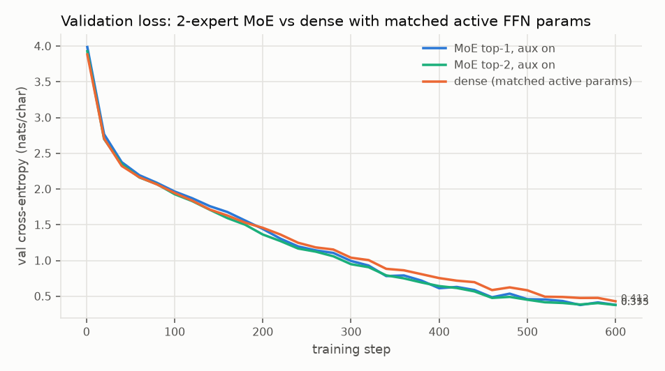
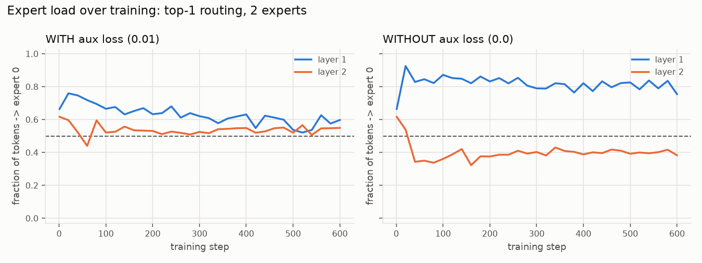
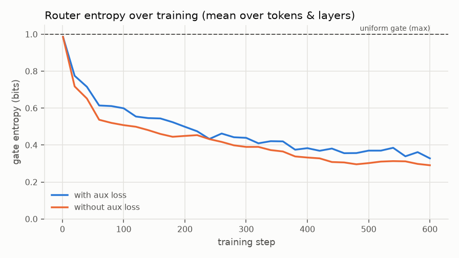
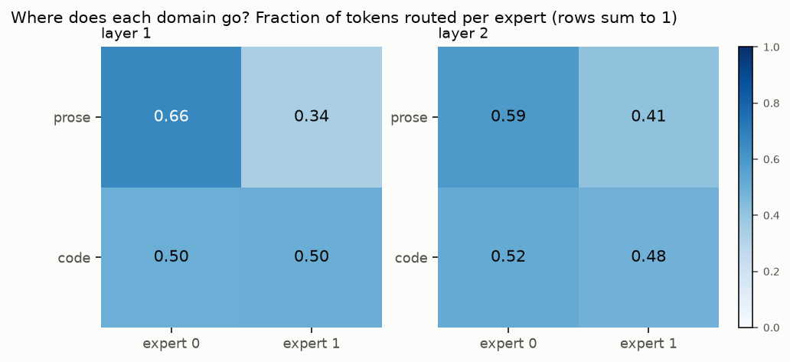
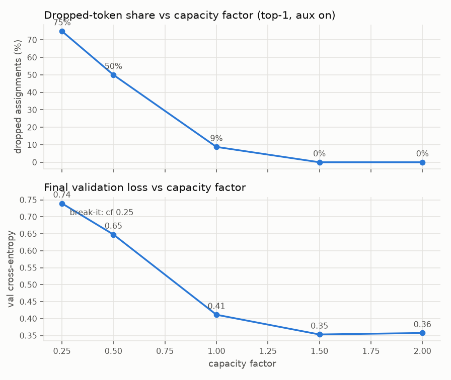
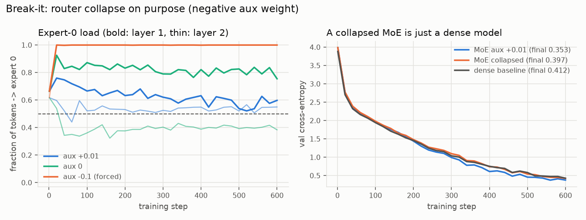
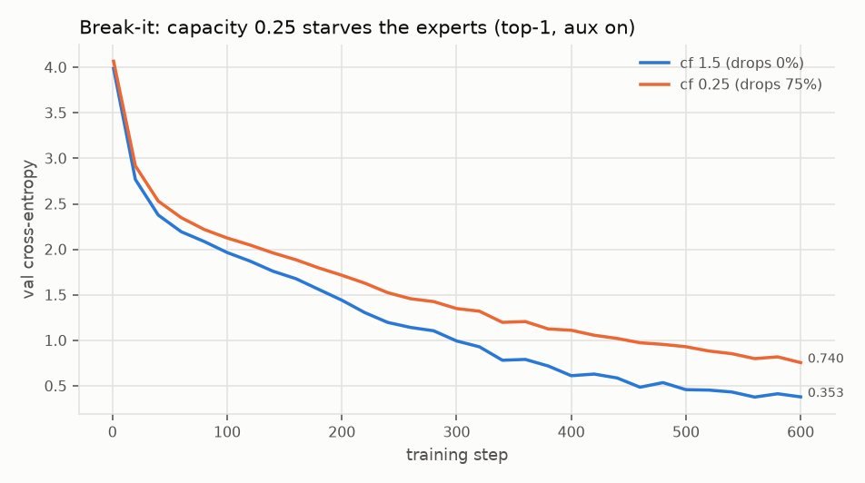
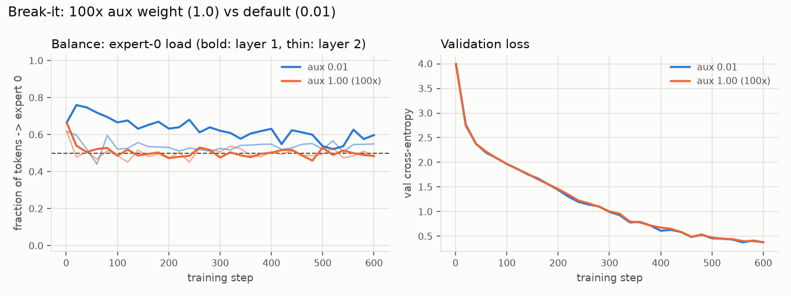

# A Two-Expert MoE Router

> Project 17 of 34 — [Step-By-Step LLM Engineering Projects (2026 Edition)](https://x.com/TheAhmadOsman/status/2058745340895870985) by [@TheAhmadOsman](https://x.com/TheAhmadOsman)
>
> **Part X: Mixture Of Experts**

## Goal

Sparse Mixture-of-Experts increases parameter count without activating every parameter per token. Build a two-expert router (Switch Transformer / Mixtral style), plot routing histograms, and ablate it into router collapse on purpose.

## The project loop

1. **Build it.** Implement the core idea yourself before using the library version.
2. **Plot it.** Loss curves, latency curves, memory curves, attention heatmaps, routing histograms, entropy plots, or failure galleries.
3. **Break it.** Ablate the thing you just built and watch what changes.
4. **Explain it.** A short technical note: what you expected, what happened, what surprised you, what you'd try next.

## Artifacts to ship

- [x] **Implementation** — clean code with tests (`moe_two_expert_router/`, 12 pytest tests)
- [x] **Notebook** — one reproducible experiment (`demo.py`, a seeded script rather than an .ipynb)
- [x] **Plots** — eight charts in `plots/`
- [x] **Failure gallery** — forced router collapse, capacity starvation, over-weighted aux loss
- [x] **Write-up** — below

---

*Status: complete — two-expert top-1/top-2 MoE with capacity + Switch aux loss, 12 green tests, `demo.py` trains 10 configs in ~4.7 min on 2 CPU threads (peak RSS ~0.5 GB).*

## What's here

| Module | Contents |
|---|---|
| `corpus.py` | Procedural ~40k-char corpus alternating English prose and Python-like code, with a per-char domain label |
| `router.py` | Softmax gate, top-1 (Switch) / top-2 (Mixtral, renormalized) assignment, first-come capacity dropping, Switch load-balancing loss `E·Σ f_e·P_e`, gate entropy |
| `moe.py` | `MoELayer`: dispatch/combine over two `ExpertFFN`s; dropped tokens contribute zero so the residual passes them through |
| `model.py` | 2-layer, d_model 96 char transformer with MoE or dense FFN (dense FFN = one expert's shape, so top-1 MoE and dense have matched active FFN params) |
| `train.py` | AdamW loop logging per-layer expert load, entropy, drop rate; prose/code routing fractions |

All runs: 600 steps, batch 16 × 64 chars, lr 3e-3, seed 0. Numbers below are copied from `results.json`; `demo.py` is deterministic and reproduces them exactly.

## Quickstart

```bash
pip install torch numpy matplotlib pytest
python demo.py      # ~5 min CPU, writes plots/*.png and results.json
pytest              # 12 tests
```

## Results

| run | routing | aux weight | capacity factor | final val CE | dropped | expert-0 load (L1, L2) | gate entropy (bits) |
|---|---|---|---|---|---|---|---|
| `moe_top1_aux` | top-1 | 0.01 | 1.5 | 0.353 | 0% | 0.60, 0.55 | 0.33 |
| `moe_top1_noaux` | top-1 | 0 | 1.5 | **0.344** | 2.5% | 0.76, 0.38 | 0.29 |
| `moe_top1_aux100x` | top-1 | 1.0 | 1.5 | 0.353 | 0% | 0.49, 0.48 | 0.45 |
| `moe_top2_aux` | top-2 | 0.01 | 1.5 | 0.376 | 0% | 0.58, 0.50 | 0.38 |
| `dense` | — | — | — | 0.412 | — | — | — |
| `collapse_forced` | top-1 | **−0.1** | 2.0 | 0.397 | 0% | **1.00, 1.00** | **0.01** |
| `cf025` | top-1 | 0.01 | 0.25 | 0.740 | 75% | 0.47, 0.47 | 0.85 |
| `cf05` | top-1 | 0.01 | 0.5 | 0.648 | 50% | 0.59, 0.54 | 0.63 |
| `cf10` | top-1 | 0.01 | 1.0 | 0.411 | 8.8% | 0.61, 0.39 | 0.36 |
| `cf20` | top-1 | 0.01 | 2.0 | 0.358 | 0% | 0.62, 0.55 | 0.32 |

MoE models have 242,880 params (74,688 active FFN params/token for top-1, 148,992 for top-2); the dense baseline has 168,192 params with 74,304 active FFN params/token.



At matched active FFN compute, the top-1 MoE beats dense (0.353 vs 0.412 nats/char): the extra expert is capacity the model gets without per-token FLOPs. Top-2 (0.376) lands between them despite doubling active FFN params.



Expert load per layer over training (the "routing histogram" over time). With aux 0.01 both layers drift toward 50/50 (0.60 / 0.55 at the end); without it layer 1 settles at ~80/20 and layer 2 at ~40/60 — imbalanced, but not collapsed.



Gate entropy falls from the 1-bit maximum to ~0.3 bits by step 600 in both runs (0.33 with aux, 0.29 without): the router becomes confident per token whether or not the batch-level load is balanced.



Prose vs code routing for the headline model. Specialization is weak: in layer 1, 66% of prose chars go to expert 0 while code splits 50/50; layer 2 is 59/41 vs 52/48. The router is splitting on something finer than the domain label.



Capacity factor vs dropped share and val loss: 0.25 → 75% dropped (0.740), 0.5 → 50% (0.648), 1.0 → 8.8% (0.411), 1.5 → 0% (0.353), 2.0 → 0% (0.358). Once drops reach zero, more capacity buys nothing.

## Failure gallery



**Router collapse on purpose.** Flipping the aux weight to −0.1 rewards imbalance; with capacity 2.0 nothing is dropped to push back. By the first logged step (20) layer 1 already sends 100% of tokens to expert 0, both layers end at 100%, and gate entropy goes to 0.01 bits. Expert 1 is dead weight, and val loss (0.397) lands next to the dense baseline (0.412) instead of the balanced MoE (0.353): a collapsed MoE is a dense model carrying unused parameters.



**Capacity starvation.** At capacity factor 0.25 each expert can take only 1/8 of the tokens, so 75% of tokens skip the FFN entirely (residual pass-through). Val loss doubles (0.740 vs 0.353). The router reacts by becoming less confident (entropy 0.85 bits).



**Over-weighting the aux loss (100×).** Load goes to almost exactly 50/50 (0.49 / 0.48) and entropy rises to 0.45 bits, but val loss is unchanged (0.353 vs 0.353). At this scale, forcing balance costs nothing — the failure I set out to show did not appear.

## Write-up

**Expected.** Without the aux loss the router would collapse onto one expert; with it, loads would balance; a 100× aux weight would hurt quality; experts would specialize into prose vs code.

**What happened.** Removing the aux loss did *not* collapse the router in 600 steps — it settled into a stable 80/20 split in layer 1, and that run had the best val loss of all (0.344). Real collapse needed a push (negative aux weight), and once collapsed the model performed like the dense baseline, which is the clearest demonstration of why MoE needs a balancing term. Capacity was the sharpest knob: below 1.0 the dropped tokens dominate everything else. Top-1 MoE beat dense at matched active params by 0.06 nats/char.

**Surprises.** (1) 100× aux weight was free — two experts is too few for balance pressure to fight the LM objective much. (2) Domain specialization was weak; the corpus labels are coarse and char-level routing probably keys on local features (whitespace, punctuation, letter classes). (3) Top-2 was worse than top-1 here, plausibly because renormalized gates average two half-trained experts on a short budget.

**Caveats.** Single seed, 600 steps, a templated corpus whose validation split shares templates with training (hence very low CE). Differences of ~0.01 nats (e.g. aux vs no-aux) are within what a different seed could flip.

**Next.** Multiple seeds with error bars; 4–8 experts, where natural collapse is more likely and aux pressure matters; router z-loss; per-character routing visualizations to see what the experts actually split on; capacity-free (dropless) dispatch for comparison.
